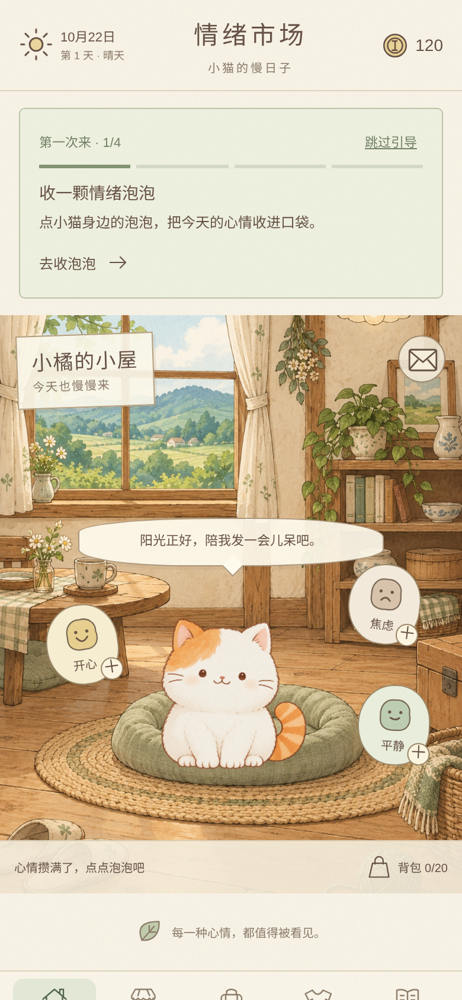

# 情绪市场 · 小猫的慢日子

一款手机竖屏的养成收集小游戏原型。小猫在生活和旅行中产生情绪，玩家把情绪卖给懂它的买家，每次成交附一段买家故事和一条情绪小科普；换来的金币用来装扮小猫，或送它去旅行。

**在线试玩：** https://mushroomkill.github.io/emotion-market/



## 先看这几份

| 文件 | 内容 |
| --- | --- |
| [系统与数值说明.md](系统与数值说明.md) | 核心循环、养成线、每个数字的理由、用模拟发现的问题和改动 |
| [买家关系与钟表匠剧情.md](买家关系与钟表匠剧情.md) | 买家好感系统，以及夜班钟表匠五次相遇的剧情和回应设计 |
| [analysis/经济与收集模拟.md](analysis/经济与收集模拟.md) | 30 天金币与收集模拟：方法、三种上线习惯、改动前后对比 |
| [analysis/买家关系数值验证.md](analysis/买家关系数值验证.md) | 第一轮模拟：只看买家相遇的节奏 |

## 玩法

1. 给小猫起名字，点它身边的泡泡收取情绪。
2. 去市场把情绪卡摆上柜台，买家到来后读故事和小百科，领取金币。
3. 准备便当送小猫旅行，途中会收到明信片，回家时带回纪念品、情绪卡，有时还有稀有装饰。
4. 用金币买装饰，在图鉴里查看六类共 94 项收藏。

试玩版做了时间加速（泡泡 8 秒一个，旅行 20 到 40 秒），底部的"进入下一天"可以切换天气和今日行情。正式版的时长和换算见《系统与数值说明》第 9 节。存档保存在当前浏览器里。

## 已实现

- 小屋：8 种情绪按天气、旅行、装扮等加权产出，离线计时，上限 3 个。
- 市场：3 格柜台、16 位买家故事、今日行情、好感回礼、24 条情绪小百科。
- 夜班钟表匠：五次相遇的连续剧情，第三次可以回应他，故事可以在图鉴里重读。
- 装扮：8 件商店装饰、6 件旅行稀有装饰，分头部、颈部、身上三个部位。
- 旅行：3 种便当、6 个目的地、12 张明信片、12 件纪念品，稀有装饰第 8 次必得。
- 图鉴：94 项收藏，每类集齐有奖励；新手引导可跳过。

## 本地运行

直接打开 `dist/index.html` 即可。如果浏览器限制了本地文件的存档，可以在项目目录运行：

```
python -m http.server 4173 --directory dist
```

然后访问 http://localhost:4173 。

验证规则：`node tests/core.test.cjs`（20 项测试）。复现模拟：`node analysis/economy-simulation.cjs`。

## 目录

- `dist/`：游戏本体（HTML、CSS、JavaScript 和美术素材），不需要构建。
- `docs/`：`dist/` 的副本，供 GitHub Pages 发布。
- `analysis/`：模拟脚本、原始结果和图表。
- `tests/`：规则测试。
- `开发记录/`：美术生成提示词、视觉规范和开发约定。
