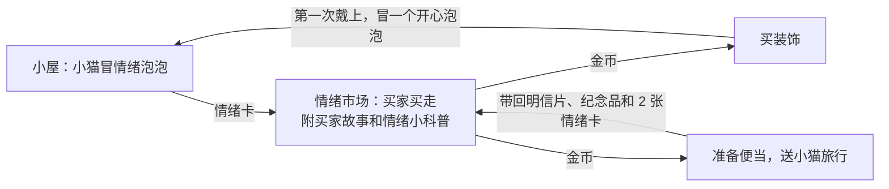
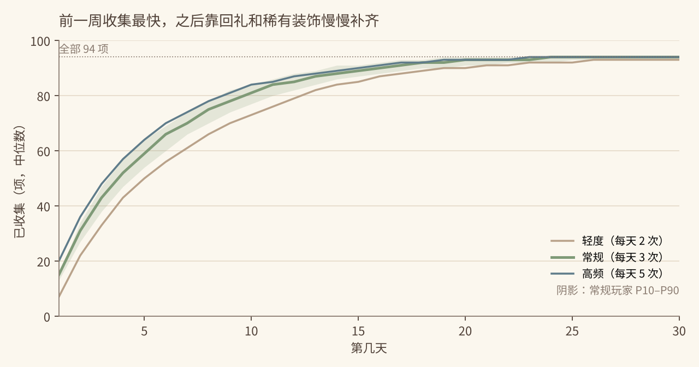
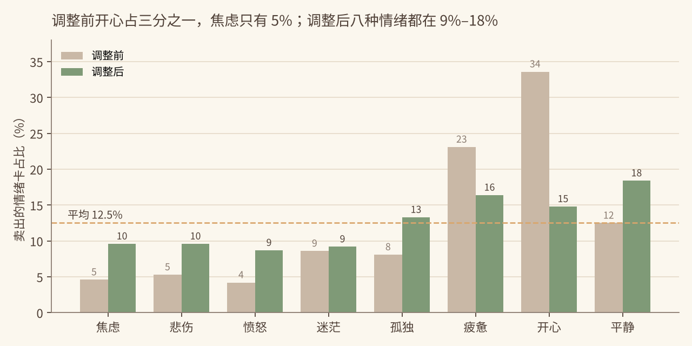
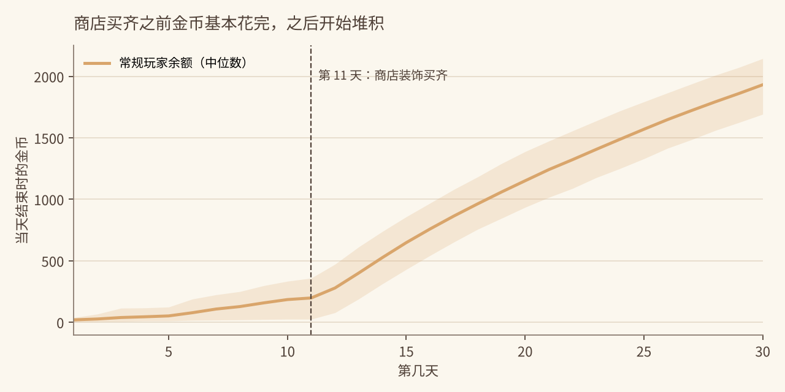

# 情绪市场 · 系统与数值说明

一只会产生小情绪的猫，玩家把它的情绪卖给懂它的人，换来的金币用来装扮小猫或送它去旅行。这份说明写的是这套循环怎么搭、每个数字为什么这么定，以及我用模拟发现并改掉了哪些问题。

文中所有天数都来自模拟（每种上线习惯各 4,000 次，固定随机种子），不是真实玩家数据。方法和原始结果在 [analysis/经济与收集模拟.md](analysis/经济与收集模拟.md)。

## 1. 设计目标

| 目标 | 怎么衡量 |
| --- | --- |
| 每天打开 2–3 次都有收获，不打开也不受罚 | 小猫在家时，泡泡处于"已攒满"状态的时间比例 |
| 八种情绪地位平等，不让"更难过"更值钱 | 卖出的情绪卡里，每种情绪的占比 |
| 前一周每天都有新东西，一个月内能把收藏补齐 | 各收集里程碑落在第几天 |

## 2. 核心循环

情绪卡是唯一的原料，金币有两个去处：装饰是看得见的即时变化，旅行是不确定的远方回报。两条路最后都会让小猫产生新的情绪，循环因此能接上。

## 3. 养成线：关系与收藏，不做等级

小猫没有等级、饥饿或精力值。这是有意的取舍：

- 这是一款情绪陪伴题材的游戏。如果"不照顾小猫就会掉数值"，玩家打开它就会带着压力，和题材的初衷相反。
- 在这套设计里，小猫是情绪的来源，不是被培养的对象。它的情绪会随天气、旅行和装扮变化，这已经能让玩家感觉它是"活的"。

所以养成感放在两条线上：

- **关系线**：16 位买家，每位来 5 次后留下专属回礼。夜班钟表匠有完整的五段剧情，第三次相遇时玩家可以回应他。
- **收藏线**：买家、回礼、情绪小百科、装饰、纪念品、明信片，共 94 项。

下表是常规玩家（每天打开 3 次）的中位数节奏：

| 第几天 | 发生了什么 |
| --- | --- |
| 第 1 天 | 第一次旅行，买下第一件装饰 |
| 第 4 天 | 带回第一件稀有装饰 |
| 第 5 天 | 收到第一份买家回礼 |
| 第 7 天 | 16 位买家见齐，24 条情绪小百科读完 |
| 第 11 天 | 商店 8 件装饰买齐 |
| 第 13 天 | 收到钟表匠的回礼，他的五段故事讲完 |
| 第 15 天 | 6 件稀有装饰集齐 |
| 第 24 天 | 16 份回礼全部收齐 |

前一周新东西最密集，用来留住新玩家。第二周以后，主要由好感回礼和稀有装饰撑起中期目标。

## 4. 每个数字为什么这么定

| 参数 | 数值 | 理由 |
| --- | --- | --- |
| 泡泡产出间隔 | 2 小时 | 上限 3 个，6 小时攒满，约等于白天两次打开之间的间隔（早、午、晚）。 |
| 泡泡上限 | 3 个 | 满了就停，不鼓励长时间不打开，也不惩罚。数量和柜台格数一致，一次收完正好摆满。 |
| 背包上限 | 20 张 | 约为常规玩家 3 天的产量（每天约 7 张），离开一两天不会被挤满。 |
| 柜台 | 3 格 | 打开时摆满，下次打开前卖完，玩家不需要守着等。 |
| 成交时间 | 30–90 分钟 | 比两次打开的间隔短，保证下次回来时都已成交。 |
| 售价 | 20–30 金币 | 平均每张 25。常规玩家每天收入约 270，扣掉旅行后约剩 110，最便宜的装饰（120）约攒一天，最贵的（400）约攒四天。 |
| 今日行情 | 一种情绪 ×1.5 价，成交时间减半 | 每天给一点变化。只影响一种情绪，且每天更换，不会让玩家长期追某一种情绪。 |
| 八种情绪基础售价 | 相同 | 设计原则：负面情绪不会因为"更难过"而更值钱。 |
| 初始金币 | 120 | 等于最便宜装饰的价格，加上新手引导送的饭团，第一次打开就能体验装扮和旅行两条线。 |
| 便当价格与时长 | 30 / 60 / 100 金币，2–4 / 4–8 / 8–12 小时 | 三档对应午休出发、白天出发、睡前出发。豪华便当的时长覆盖整夜，小猫在玩家睡觉时出门，正好避开夜里泡泡溢出。 |
| 稀有装饰概率 | 5% / 10% / 20%，第 8 次必得 | 让稀有装饰在商店买齐之后才集齐（第 15 天对第 11 天），保持"稀有"的感觉。保底保证最多连续 7 次空手。 |
| 重复纪念品 | 折成 20 金币 | 小小的补偿，不让重复变成纯粹的损失。 |
| 好感回礼 | 第 5 次，另加 50 金币 | 5 次正好容纳钟表匠"初见、转折、回礼"的剧情节奏。 |
| 没见过的买家 | 出现权重 ×2 | 让新买家先露面，常规玩家约第 7 天见齐。 |
| 情绪小百科 | 每种情绪 3 条 | 每种情绪卖 3 次就能读完，约第 7 天读完全部 24 条。 |
| 图鉴每类集齐 | 100 金币 | 给长期目标一个收尾。 |

## 5. 情绪从哪里来

每个泡泡的情绪按权重抽取，八种情绪的基础权重都是 1，再按下表叠加修正。

| 情绪 | 来源 |
| --- | --- |
| 焦虑 | 阴天 ×1.5，灯塔岛旅行 |
| 悲伤 | 雨天 ×2，海边小镇旅行 |
| 愤怒 | 古城集市旅行 |
| 迷茫 | 阴天 ×1.5，古城集市旅行 |
| 孤独 | 超过 12 小时没打开 ×3，雪山小屋、灯塔岛旅行 |
| 疲惫 | 旅行回来 6 小时内 ×2，竹林温泉、花田旅行 |
| 开心 | 晴天 ×2，戴上新装饰 2 小时内 ×2（并立刻得到一张），花田旅行 |
| 平静 | 雨天 ×1.5，海边小镇、竹林温泉、雪山小屋旅行 |

旅行回来带的 2 张情绪卡，就是目的地对应的那两种情绪。

## 6. 用模拟发现的问题和改动

第一版规则写好后，我把整套规则放进 30 天的模拟里跑了一遍，发现三个直觉上看不出来的问题。

**问题一：开心卡占了三分之一，焦虑只有 5%。** 好几条规则都在往"开心"和"疲惫"上加权重：旅行带回的第二张卡固定是开心或疲惫，旅行回来 6 小时内两者都 ×2，小猫又几乎每天出门两次。结果"八种情绪平等"的原则在实际产出里被打破了。最直接的后果是，故事最完整的夜班钟表匠（买焦虑）反而最难见到：常规玩家中位数要到第 24 天才收到他的回礼，30 天内有约三成玩家等不到。

**问题二：泡泡大部分时间是满的。** 原来 1 小时一个，3 小时就满了，而常规玩家两次打开之间往往隔 4 到 9 个小时。小猫在家的时间里，约 40% 处于"已满、不再产出"的状态。

**问题三：稀有装饰比商店装饰更早集齐。** 原来的概率加上第 6 次保底，稀有装饰中位数第 10 天就集齐了，比商店买齐还早，"稀有"名不副实。

改动如下。我只调了数值和情绪来源，没有增加新系统：

| 改了什么 | 原来 | 现在 |
| --- | --- | --- |
| 泡泡产出间隔 | 1 小时 | 2 小时 |
| 旅行带回的情绪卡 | 目的地情绪 1 张 + 开心或疲惫 1 张 | 目的地的两种情绪各 1 张 |
| 旅行回来的加成 | 开心、疲惫 ×2 | 只有疲惫 ×2 |
| 阴天的加成 | 迷茫、疲惫 ×1.5 | 焦虑、迷茫 ×1.5 |
| 目的地情绪 | 平静出现 4 次，焦虑、愤怒、悲伤没有 | 每种情绪至少出现在一个目的地 |
| 稀有装饰 | 10% / 20% / 35%，第 6 次必得 | 5% / 10% / 20%，第 8 次必得 |
| 初始金币 | 80 | 120 |

改动前后的对比（常规玩家，每天打开 3 次，中位数；两组用同样的玩家行为）：

| 指标 | 改动前 | 改动后 |
| --- | --- | --- |
| 在家时泡泡已满的时间占比 | 40% | 10% |
| 焦虑卡占比 / 开心卡占比 | 5% / 34% | 10% / 15% |
| 买下第一件装饰 | 第 2 天 | 第 1 天 |
| 商店装饰买齐 | 第 11 天 | 第 11 天 |
| 稀有装饰集齐 | 第 10 天 | 第 15 天 |
| 钟表匠回礼（中位数 / 九成玩家） | 第 24 天 / 30 天内只有 71% | 第 13 天 / 第 22 天 |
| 30 天内收齐全部 16 份回礼 | 11% 的玩家 | 84% 的玩家 |

## 7. 金币的进与出

常规玩家每天卖出约 7 张情绪卡，收入约 270 金币（含回礼和图鉴奖励）。旅行每天约花 160 金币（白天带三明治，睡前带豪华便当），剩下的钱用来买装饰。

商店买齐之前，金币基本是"挣多少花多少"；第 11 天以后金币开始堆积，30 天时中位数约 1,900。这是目前最明显的缺口，见下一节。

## 8. 还没解决的问题

- **第二周以后金币缺少去处。** 正式版需要一个持续的消耗，比如按季节更新的限定装饰。原型阶段先不做。
- **每天只打开 2 次的玩家会被柜台卡住。** 3 格柜台意味着每天最多卖 6 张，而产量约 6.5 张，30 天里约有 27 次因为背包满了收不了泡泡。我暂时接受这一点，因为它不会扣东西，只是不额外奖励。之后可以考虑"背包满时柜台自动补货"。
- **情绪占比还不完全均匀。** 愤怒只有一个来源，占 9%；平静有四个来源，占 18%。都在可接受范围内，但愤怒的两位买家相对更难遇见。
- **钟表匠回礼仍有长尾。** 约一成玩家要到第 22 天以后。如果试玩中发现玩家很想继续这段故事却等不到，可以考虑让见过面的买家偶尔主动来访。
- **所有结论都来自模拟。** 真实玩家的上线时间、选卡习惯和是否读科普，需要通过试玩来验证。情绪小科普在正式上线前也需要专业人士审核。

## 9. 原型里的时间换算

为了几分钟内能玩完一轮，试玩版做了加速。规则本身和上面完全一致。

| 项目 | 正式版 | 试玩版 |
| --- | --- | --- |
| 泡泡产出 | 每 2 小时 | 每 8 秒 |
| 成交 | 30–90 分钟（今日行情减半） | 4–8 秒（今日行情减半），首单 10 秒 |
| 旅行 | 2–4 / 4–8 / 8–12 小时 | 20 / 30 / 40 秒 |
| 新装饰加成 | 2 小时 | 2 分钟 |
| 旅行归来加成 | 6 小时 | 6 分钟 |
| 换天（天气、行情） | 每天 0 点 | 点"进入下一天" |
